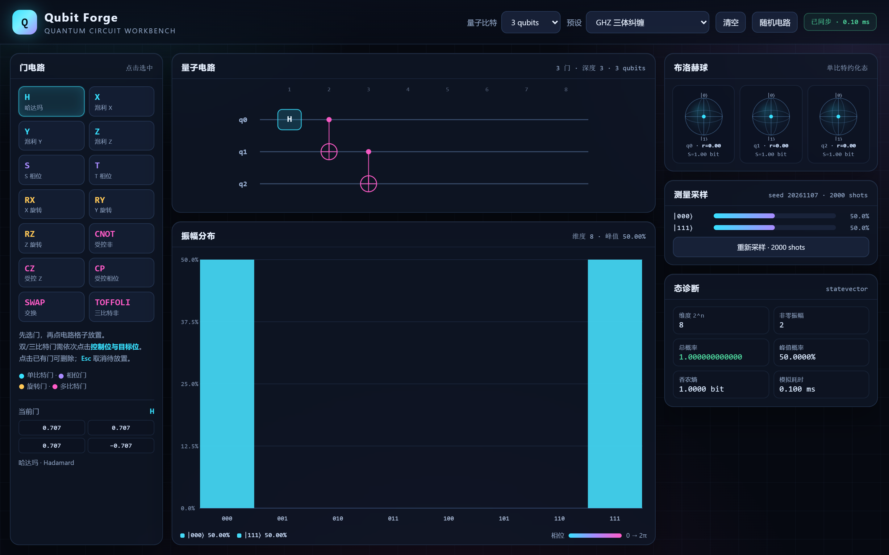
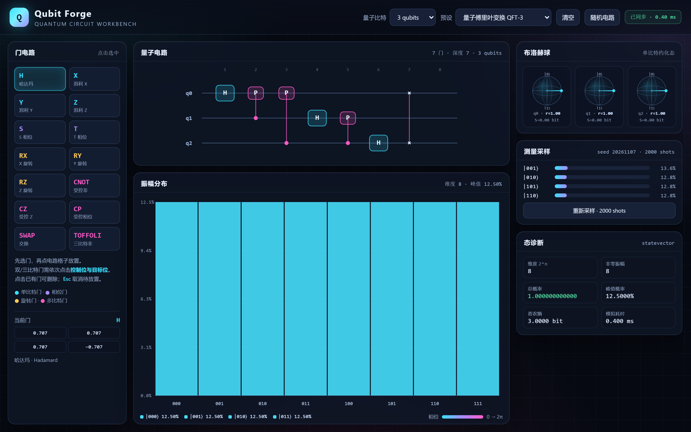
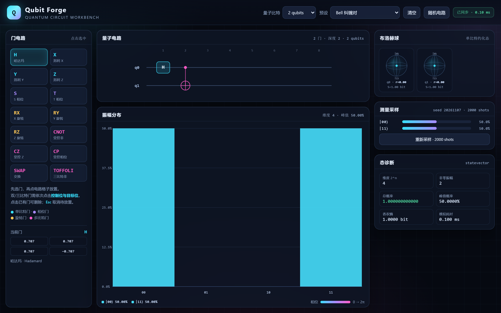
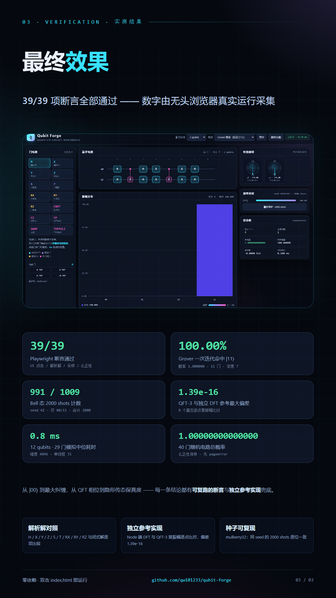

# Qubit Forge · 量子电路工坊

一个**单文件、零依赖、可直接双击打开**的量子电路模拟器。点选量子门搭出电路，浏览器里实时求解
2^n 维复振幅态矢量，并把振幅、相位、纠缠与测量结果画出来。



## 项目背景

量子计算的入门门槛往往不在概念，而在“看不见”：叠加、相位、纠缠都只是公式。
Qubit Forge 把 statevector 摊开在画布上——每一个基态的振幅高度、复数相位颜色、每个比特的
布洛赫向量与边缘熵、固定种子的测量计数——让抽象概念可以被点击、对照和复现。

它同时是一份**可证伪的实现**：39 项自动化断言用解析解与独立 DFT 参考逐点核对结果，
而不是只画一张好看的图。

## 功能

- **statevector 引擎**：最多 12 qubits（4096 维），复数用 `Float64Array` 实部/虚部分离存储。
- **14 种门**：`H X Y Z S T RX RY RZ CNOT CZ CP SWAP Toffoli`。
- **点选式电路编辑**：选门 → 点格子放置；双/三比特门依次点控制位与目标位；
  点已有门删除；`Esc` 取消待放置；同列冲突实时拦截。
- **7 个预设**：Bell、GHZ-3、QFT-3、Grover（标记 `|11⟩`）、Deutsch–Jozsa（平衡）、
  量子隐形传态、5 比特均匀叠加。
- **可视化**：振幅直方图（相位 → 青→洋红色相）、每比特布洛赫球、纠缠熵、测量采样、
  态诊断（维度 / 非零振幅 / 总概率 / 峰值 / 香农熵 / 实测耗时）、当前门矩阵预览。
- **可复现采样**：2000 shots，mulberry32 固定种子，同 seed 逐位一致。
- **调试 API**：`window.qubit` 暴露 `setCircuit / getState / getBloch / sample / ...`，
  页面中的一切结论都能被脚本复算。

## 界面预览

| 振幅与相位（QFT） | Bell 态：纠缠与采样 |
|---|---|
|  |  |

## 安装与运行

无需构建、无需 npm：

```bash
# 直接双击 index.html，或
start index.html        # Windows
open index.html         # macOS
```

任意现代 Chrome / Edge / Firefox 均可运行（纯 SVG + Canvas 2D，不依赖 WebGL）。

### 重新跑验证

需要 Node 与 Playwright：

```bash
# PowerShell 示例（按本机实际路径调整）
$env:NODE_PATH="<path-to-node_modules-containing-playwright>"
node tools/verify.mjs
```

通过时输出：

```text
PASS: 39/39 checks passed
verification.json written.
```

结果写入 `tools/verification.json`。重新生成截图与 9:16 图文：

```bash
node tools/shots.mjs
node tools/make-slides.mjs   # 读取 verification.json → 渲染 PNG → 做溢出/重叠 QC
```

## 验证结果（真实运行采集）

| 项目 | 实测值 | 说明 |
|---|---|---|
| 断言通过 | **39 / 39** | UI 点击、门矩阵、纠缠、采样、幺正性、性能 |
| Bell 采样 | **991 / 1009**（2000 shots, seed 42） | 只出现 `00`/`11`，4σ 内 |
| Grover 命中 | **P(\|11⟩) = 1.0000000000000004** | 一次迭代 100% |
| QFT 对比 DFT | **max deviation = 1.39e-16** | 8 个基态逐点复振幅 |
| 隐形传态 | **fidelity = 1.000000** | q2 布洛赫向量复原 |
| 12 qubits | **0.8 ms**（4096 维，29 门，中位数） | 单线程 JS |
| 40 门随机电路 | **总概率 1.00000000000000** | 幺正性 |

完整逐项清单见 [`tools/verification.json`](tools/verification.json)。

## 项目结构

```
qubit-forge/
├── index.html                 # 全部实现（HTML + CSS + JS，单文件零依赖）
├── PROJECT.md                 # 给 AI 的项目说明（判重 / 接手用）
├── README.md
├── screenshots/               # 演示截图（1440×900 @2x）
│   ├── demo-ui.png
│   ├── demo-bell.png
│   ├── demo-qft.png
│   ├── demo-grover.png
│   ├── demo-teleport.png
│   ├── demo-stage.png         # 电路 + 振幅特写
│   └── demo-panels.png        # 布洛赫球 + 采样 + 诊断特写
├── slides/                    # 9:16 图文 HTML 源（1080×1920）
│   ├── slide1.html            # 项目简介
│   ├── slide2.html            # 核心功能演示
│   └── slide3.html            # 最终效果 / 验证
├── deliverables/              # 9:16 渲染成品（1080×1920 PNG）
│   ├── slide1.png
│   ├── slide2.png
│   └── slide3.png
└── tools/
    ├── verify.mjs             # 39 项 Playwright 断言
    ├── shots.mjs              # 演示截图
    ├── make-slides.mjs        # 图文生成 + 溢出/重叠 QC
    ├── verification.json      # 验证结果（图文数据唯一来源）
    └── slide-qc.json          # 图文 QC 报告
```

## 9:16 图文成品

<p>
  
  
  
</p>

三张图文的数据均由 `tools/verification.json` 注入，不手写数字；渲染后逐块检查越界、
重叠与退化尺寸，见 [`tools/slide-qc.json`](tools/slide-qc.json)。

## 技术细节

- **比特序**：qubit 0 为最高位（MSB），与标准 QFT 教材电路与位串显示一致。
- **单比特门**：按 `stride = 1 << (n-1-q)` 成对更新，避免构造整矩阵。
- **多比特门**：按掩码直接操作振幅对（CNOT / CZ / CP / SWAP / Toffoli）。
- **QFT**：H + 受控相位 + 末端 SWAP，与独立 DFT 参考逐点一致（误差 1.39e-16）。
- **布洛赫向量**：由约化密度矩阵 `ρ01` 求 `(x, y, z)`，边缘熵由 `r` 求闭式解。
- **采样**：累积分布 + 二分查找，种子为 mulberry32。

## License

MIT
